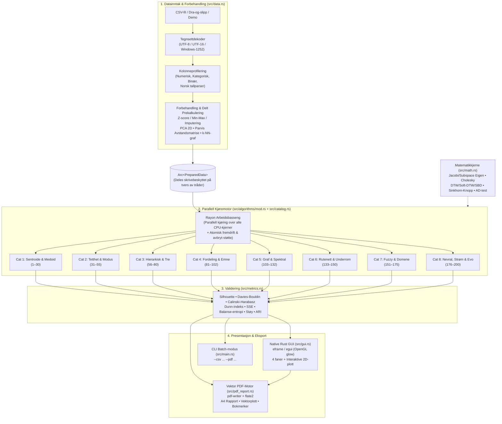
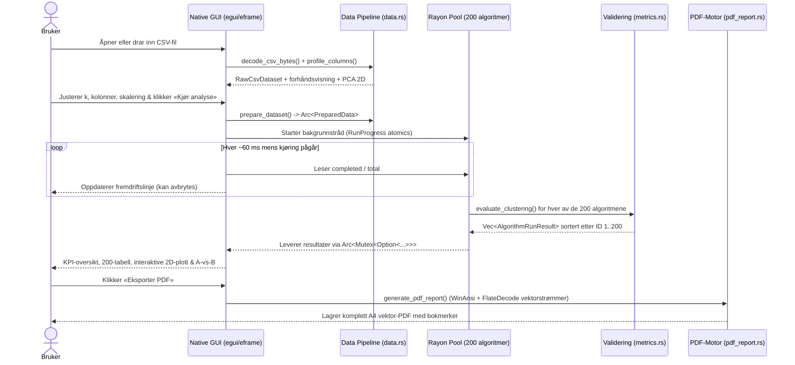
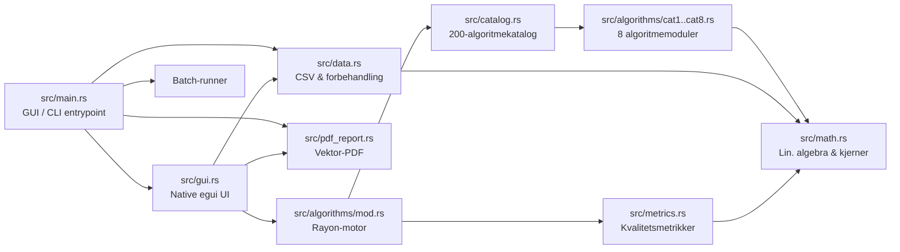

# ClusterOverview

> **Komplett skrivebordsplattform for klyngeanalyse i ren Rust** — med native GUI (`eframe`/`egui`, helt uten HTML/WebView), **200 klyngealgoritmer** fordelt på 8 kategorier og direkte eksport til publikasjonsklar **vektor-PDF**.

---

## Hovedfunksjoner

- **Native Rust-GUI (`eframe`/`egui` + `rfd`)** — lynrask, GPU-akselerert skrivebordsapplikasjon uten nettlesermotor eller WebView.
- **Smart CSV-import** — dra-og-slipp CSV rett inn i vinduet, automatisk deteksjon av tegnsett (**UTF-8**, **UTF-16 LE/BE**, **Windows-1252 / ISO-8859-1**), skilletegn (`,`, `;`, `\t`, `|`), norske tallformater med tusenskille (`39 100`) og desimalkomma, samt automatisk filtrering av ID- og konstantkolonner.
- **Alle 200 klyngealgoritmer (8 kategorier)** — kjøres parallelt over alle tilgjengelige CPU-kjerner med `rayon`, trygg feilfangst per algoritme og live fremdriftsindikator.
- **Interaktiv inspeksjon & sammenligning** — sorterbar resultattabell, interaktivt 2D-spredningsplott (PCA 2D eller valgfrie råkolonner med hover-tooltips), samt side-om-side A-vs-B-sammenligning med *Adjusted Rand Index*.
- **Publikasjonsklar vektor-PDF (`pdf-writer` + `flate2`)** — A4-rapport med forside og KPI-kort, innholdsfortegnelse med eksakte sidetall, datasettprofil & 2D PCA-projeksjon, kategoridiagram, Topp-20 toppliste, individuelle algoritmekort med 2D vektor-spredningsplott (6 kort per side), klikkbare PDF-bokmerker (Outline), fulle norske tegn (`æøåÆØÅ`) og komplett 200-raders vedleggstabell.
- **Valgfri CLI-modus** — kjør hele 200-algoritmerspipen og generer PDF direkte fra kommandolinjen for skripting og batch-jobber.

---

## Bilder


## Systemarkitektur



---

## Interaktiv Dataflyt (GUI & Bakgrunnskjøring)



---

## Moduloversikt



| Fil | Ansvar |
| --- | --- |
| `src/main.rs` | Oppstart for native GUI (standard) samt valgfri CLI-modus og integrasjonstester |
| `src/gui.rs` | Skrivebords-GUI i `eframe`/`egui` med dra-og-slipp, kolonnevelger, fremdriftslinje, interaktive 2D-plott og A-vs-B-sammenligning |
| `src/data.rs` | Dekoding av UTF-8/UTF-16/Windows-1252, auto-skilletegn, norsk tallparser, skalering, one-hot/binær/kategorisk representasjon, PCA 2D, parvis avstand og k-NN-graf |
| `src/math.rs` | Egenverdier (Jacobi & ortogonal underromsiterasjon), Cholesky invers/logdet, DTW/Soft-DTW, Shape-Based Distance, Sinkhorn-Knopp og Anderson-Darling |
| `src/metrics.rs` | Silhouette, Davies-Bouldin, Calinski-Harabasz, Dunn-indeks, Inertia/SSE, balanse-entropi og Adjusted Rand Index (ARI) |
| `src/catalog.rs` | Komplett register over alle 200 algoritmer med norsk beskrivelse, kategori og dispatcher |
| `src/algorithms/mod.rs` | Parallell Rayon-kjøremotor med atomisk fremdrift, avbryt-støtte og `catch_unwind`-beskyttelse |
| `src/algorithms/cat1..cat8.rs` | Implementasjon av samtlige 200 klyngealgoritmer fordelt på de 8 hovedkategoriene |
| `src/pdf_report.rs` | Ren Rust vektor-PDF-generator (`pdf-writer` + `flate2`) med forside, KPI-er, kategoridiagrammer, 2D vektorplott, bokmerker og vedleggstabell |

---

## De 200 algoritmene (8 kategorier)

| # | Kategori | Spenn | Antall | Eksempler |
| - | --- | --- | ---: | --- |
| 1 | Sentroide-, medoid- og partisjoneringsbaserte | `1–30` | 30 | K-Means (Lloyd), K-Means++, PAM, CLARA, CLARANS, K-Modes, K-Prototypes, X-Means, G-Means, Elkan, Hamerly, Kernel K-Means, FasterPAM, Trimmed/Power/W-K-Means, LBG |
| 2 | Tetthets- og modusbaserte algoritmer | `31–55` | 25 | DBSCAN, HDBSCAN, OPTICS, Mean Shift, DENCLUE 1/2, SNN, PDBSCAN, DBCLASD, ST-DBSCAN, Quickshift, Medoidshift, RNN-DBSCAN, DeBaCl, DBSCAN++, GriDBSCAN, MR-DBSCAN, VDBSCAN, DPC, OPTICS-OF |
| 3 | Hierarkiske og trebaserte algoritmer | `56–80` | 25 | SLINK, CLINK, UPGMA, Ward, WPGMA, UPGMC, WPGMC, DIANA, BIRCH, CURE, CHAMELEON, ROCK, MONA, Genie, HCA-DBSCAN, BUBBLE, Lance-Williams, Minimax, Flexible Beta, Neighbor-Joining, PERCH, GRINCH, BICO, SCC, Finch |
| 4 | Fordelings-, statistikk- og emnemodeller | `81–102` | 22 | GMM, Bayesian DPGMM, LDA, pLSA, COBWEB, CLASSIT, AutoClass, Student's t-Mixture, vMF, LCA, HDP, NMF, MCLUST (EII–VVV), Mixmod, Poisson/Bernoulli Mixture, DMM, Skew-Normal, IGMM, CTM, BTM, SNOB |
| 5 | Graf-, spektral- og nettverksalgoritmer | `103–132` | 30 | Spectral (NJW), Normalized Cuts, Ratio Cut, Affinity Propagation, Louvain, Leiden, MCL, LPA, Chinese Whispers, Girvan-Newman, Infomap, Walktrap, CNM, Leading Eigenvector, Spinglass, HCS, FLUIDC, Kernighan-Lin, METIS, Chaco, OSLOM, BigCLAM, SLPA, CPM, DEMON, SBM, DC-SBM, PIC |
| 6 | Rutenett-, underroms- og projeksjonsbaserte | `133–150` | 18 | STING, CLIQUE, WaveCluster, PROCLUS, SUBCLU, ORCLUS, DOC, MAFIA, OptiGrid, BANG, ENCLUS, FINDIT, COSA, FIRES, INSCY, P3C, STATPC, Sparse Subspace Clustering (SSC) |
| 7 | Fuzzy, biclustering, tidsserie- og domenespesifikke | `151–175` | 25 | FCM, PCM, Gustafson-Kessel, Gath-Geva, KFCM, sFCM, Cheng-Church, PLAID, Bimax, ISA, FABIA, k-Shape, DBA, Soft-DTW, ROCKET, SLIC, Watershed, DBSCAN-3D, TRACLUS, Consensus (Monti), CSPA, HGPA, MCLA, Multi-View K-Means, Co-reg. Multi-View Spectral |
| 8 | Nevrale, dype, strømmebaserte og evolusjonære | `176–200` | 25 | SOM, Growing Neural Gas, Fuzzy ART, Neural Gas, GCS, DEC, IDEC, DCN, VaDE, DEPICT, JULE, DAC, IIC, SCAN, SwAV, DeepCluster, Contrastive Clustering, CluStream, DenStream, StreamKM++, ClusTree, D-Stream, EVO-KMeans (GKA), PSO-Clustering, ACO-Clustering |

---

## Komme i gang

### Forutsetninger
- Rust toolchain (`rustc` + `cargo`, edition 2021+)

### Starte native GUI
```powershell
git clone https://github.com/roblar658/clusterOverview.git
cd clusterOverview
cargo run --release
```

### Valgfri CLI-modus (batch / automatisering)
```powershell
cargo run --release -- --csv sample_data/iris_demo.csv --pdf rapport_iris.pdf --k 3
```

Tilgjengelige flagg:
- `--csv <sti>` — sti til CSV-fil
- `--pdf <sti>` — sti til PDF-rapport som skal genereres
- `--k <tall>` — ønsket antall klynger (utelates for automatisk Silhouette-estimering)
- `--max-samples <tall>` — maks rader i sammenlignbart utvalg (standard: `240`)
- `--compact` — kompakt tabellrapport uten individuelle 2D-spredningsplott-kort

### Kjøre tester
```powershell
cargo test
```

Testsuiten verifiserer at samtlige 200 algoritmer er riktig registrert i rekkefølge (`1..=200`), kjører feilfritt på innebygd datasett og produserer en gyldig flersidig vektor-PDF.

---

## Windows-installasjon (WiX v4 MSI)

Prosjektet inkluderer komplett **WiX Toolset v4** konfigurasjon i `wix/` som bygger et ferdig Windows-installasjonsprogram (`.msi`) med lisensvisning, valg av installasjonsmappe, Start-meny-snarvei, skrivebordssnarvei og eksempelfiler (`sample_data/`).

### Forutsetninger for MSI-bygging
- [WiX Toolset v4](https://wixtoolset.org/) (`dotnet tool install --global wix`)
- UI-utvidelsen (`wix extension add -g WixToolset.UI.wixext`)

### Bygge `.msi`-installasjonsfilen
```powershell
.\wix\build_msi.ps1 -Profile release
```

(Bruk `-Profile debug` dersom du vil pakke en rask debug-build uten å kompilere en separat release-target.)

Ferdig installasjonsfil genereres til:
```text
wix\out\ClusterOverview-1.0.0-x64.msi
```

---

## Lisens og opphavsrett

Copyright © 2026 **Robert Larsen**.

Utgitt under **MIT-lisensen** — se [LICENSE](LICENSE) for fullstendige vilkår.
